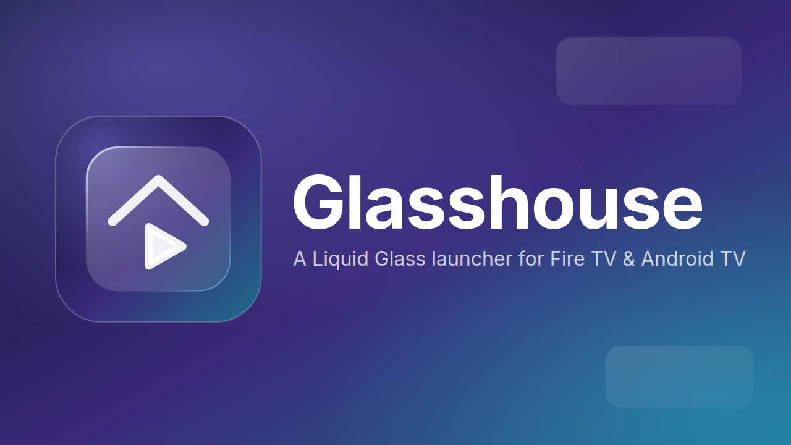
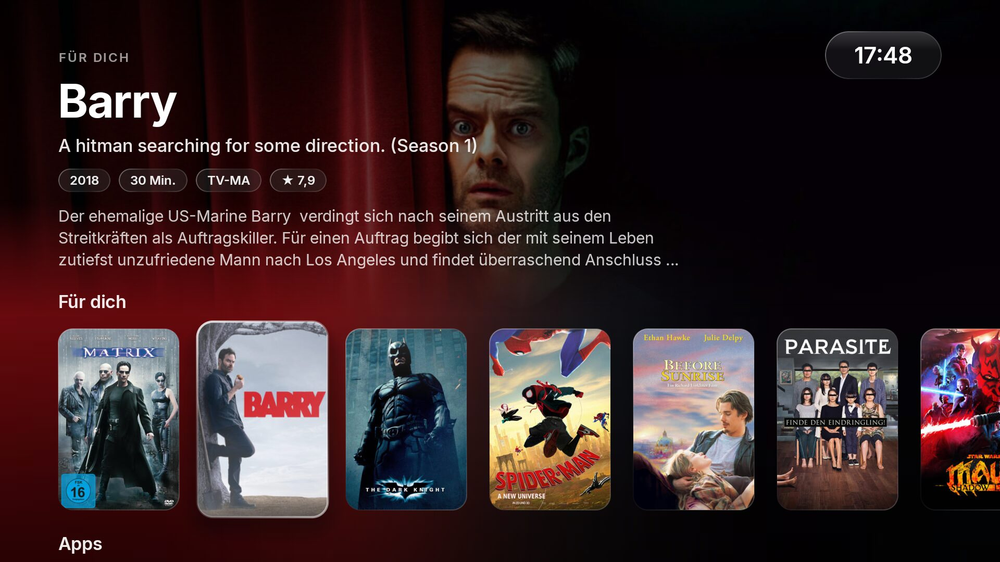
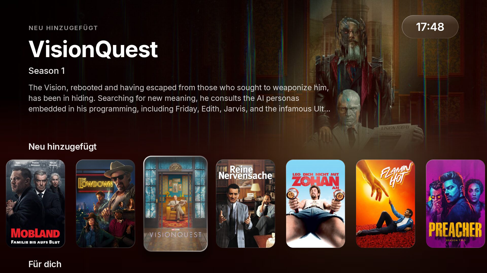
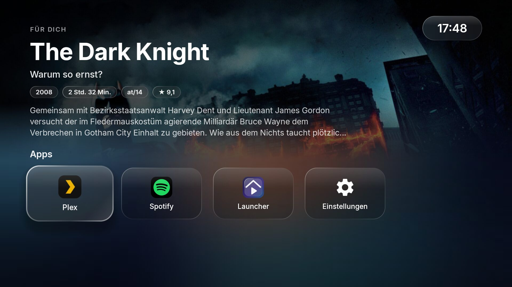
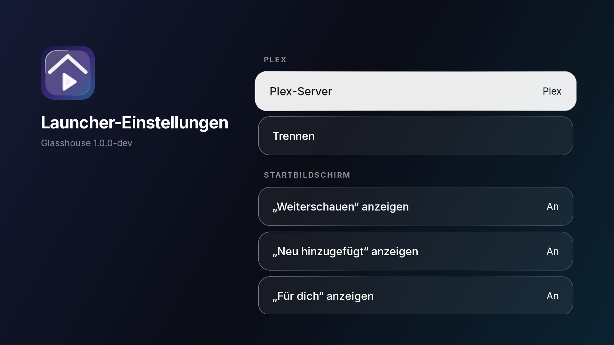

<p align="center">
  
</p>

<p align="center">
  <a href="https://github.com/raphaelbleier/glasshouse/actions/workflows/build.yml"></a>
  <a href="https://github.com/raphaelbleier/glasshouse/releases/latest"></a>
  <a href="LICENSE"></a>
</p>

**Glasshouse** is a home screen for Fire TV and Android TV that puts your own **Plex** library first — with an Apple tvOS-style *Liquid Glass* look, no ads and no sponsored rows. It replaces the Fire TV home screen without root and can turn the screensaver into any web page, such as a Home Assistant or homelab dashboard.

<p align="center">
  
  
  
  
</p>

## Features

- **Plex first** — *Continue Watching*, *Recently Added* and *For You* straight from your server, with full-screen artwork, metadata chips and a summary of whatever is focused. Selecting an item opens it in the Plex app.
- **Liquid Glass design** — progressive blur under the rows, frosted capsules, specular rims, a soft lift shadow and a light sweep on focus. Tuned for weak TV GPUs (a single cached backdrop layer, blur rendered by the Plex server).
- **Fast** — last library state cached on disk (instant start, even offline), images cached up to 400 MB, backdrops prefetched, refresh every 5 minutes with backoff when the server is away.
- **Replaces the Fire TV home screen** without root, and keeps doing so after reboots.
- **Web page screensaver** — show any URL (dashboard, photo frame, …) after 5–60 minutes; optional *never sleep*.
- **Configurable** — Plex sign-in with a code at plex.tv/link, server picker, toggle each row, pick the apps in the dock.
- English and German UI.

## Requirements

- Fire TV with Fire OS 7/8, or an Android TV / Google TV device (Android 9+)
- A Plex Media Server and the [Plex app](https://www.plex.tv/apps-devices/) on the TV
- A computer with [`adb`](https://developer.android.com/tools/releases/platform-tools) for the one-time setup

## Install

1. Enable **ADB debugging** on the TV (Fire TV: *Settings → My Fire TV → Developer options*) and connect:
   ```sh
   adb connect <tv-ip>:5555
   ```
2. Download the latest `glasshouse-*.apk` from [Releases](https://github.com/raphaelbleier/glasshouse/releases/latest) and install it:
   ```sh
   adb install glasshouse-*.apk
   ```
3. Grant the setup permission. It lets Glasshouse manage the home screen redirect, screensaver and sleep timeout — and re-apply them after Fire OS resets them on boot:
   ```sh
   adb shell pm grant io.github.raphaelbleier.glasshouse android.permission.WRITE_SECURE_SETTINGS
   adb shell appops set io.github.raphaelbleier.glasshouse WRITE_SETTINGS allow
   ```
4. Open Glasshouse once (*Apps* on Fire TV, or `adb shell monkey -p io.github.raphaelbleier.glasshouse 1`). On Fire TV it now takes over the Home button.
5. Go to the **Launcher** tile → **Plex server**, open [plex.tv/link](https://plex.tv/link) on your phone and enter the code shown on the TV.

On Android TV / Google TV you can instead pick Glasshouse as the default home app (where the device allows it); the Fire TV redirect is only used on Fire OS.

### Headless setup

Everything can also be configured over adb, e.g. for a fleet of TVs (only the adb shell is allowed to send this):

```sh
adb shell am broadcast -n io.github.raphaelbleier.glasshouse/.ConfigReceiver \
  --es server http://192.168.1.10:32400 --es token <plex-token> --es server_name "My Plex" \
  --es screensaver_url https://dashboard.example.org --ei screensaver_minutes 15 --ez never_sleep true
```

## How it works

Fire OS does not let you change the launcher. Glasshouse ships a tiny accessibility service that only watches for Amazon's home screen and brings Glasshouse to the front instead — the same approach other Fire TV launchers use. Fire OS also wipes accessibility services and the sleep timeout at boot, so a boot receiver re-applies your settings about 30 seconds after startup.

Glasshouse talks only to `plex.tv` (sign-in, server discovery) and to your own Plex server. The token stays in the app's private storage on the TV.

## Build

```sh
./gradlew assembleRelease
```

- **Fonts:** the repository bundles [Inter](https://rsms.me/inter/) (SIL OFL). To use another font, put files with the same names (`display_regular`, `display_medium`, `display_semibold`, `display_bold`, `text_regular`, `text_medium`, `text_semibold`) into `app/fonts-private/font/` — that folder is git-ignored and replaces Inter in your local builds.
- **Signing:** release builds use `keystore.properties` (`STORE_FILE`, `STORE_PASSWORD`, `KEY_ALIAS`, `KEY_PASSWORD`) or the `GLASSHOUSE_*` environment variables; without them the debug key is used. CI signs tagged releases with the repository secrets.

Pushing a tag `vX.Y.Z` builds a signed APK and publishes it as a GitHub release.

## Uninstall

```sh
adb uninstall io.github.raphaelbleier.glasshouse
```

Fire OS restores its own home screen and screensaver after the next reboot.

## Credits

Built with Jetpack Compose for TV and [Coil](https://coil-kt.github.io/coil/). Typeface: [Inter](https://github.com/rsms/inter) by Rasmus Andersson (SIL Open Font License 1.1).

Glasshouse is an independent project and is not affiliated with Plex, Amazon, Google or Apple. All trademarks belong to their owners.

## License

[MIT](LICENSE)
